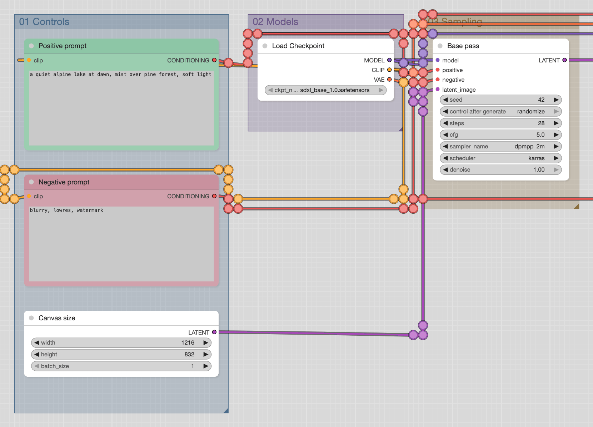
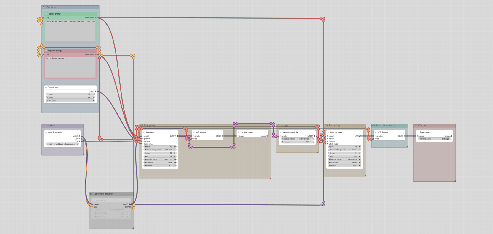
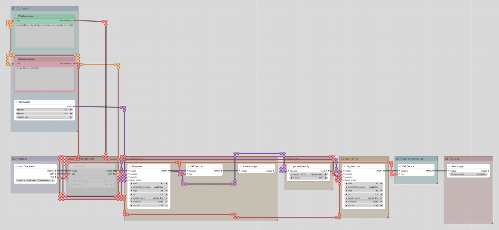
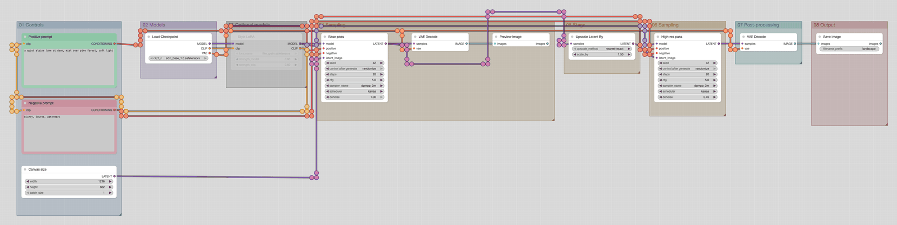
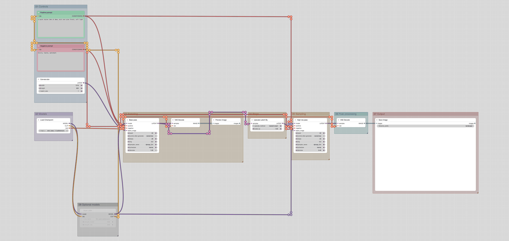
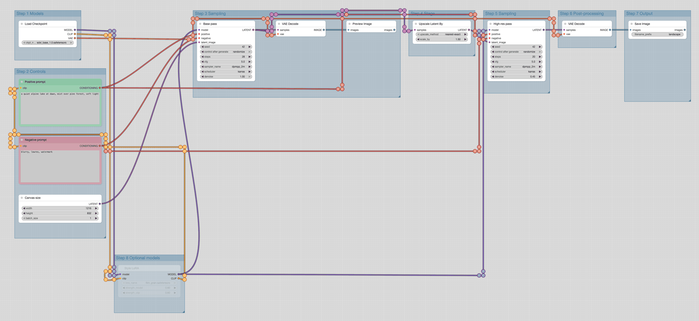

<p align="right"><a href="README.zh-CN.md">中文</a></p>

<h1 align="center">comfyui-workflow-compiler</h1>

<p align="center">
  <code>cwc</code> turns a ComfyUI API graph, written by a coding agent or by hand, into a canvas
  a person can read: grouped, laid out, linked with native reroutes, and checked to export the
  same prompt it was compiled from.
</p>

<p align="center"><code>pip install .</code> then <code>cwc compile graph.json -o out</code></p>

<p align="center">
  <picture>
    <source media="(prefers-color-scheme: dark)" srcset="docs/images/hero-dark.png">
    
  </picture>
</p>

The left part of the canvas `cwc compile` writes for the nine-node graph in
[`docs/images/src/hires.json`](docs/images/src/hires.json), a text-to-image graph with a
high-res pass. It is a screenshot of the ComfyUI frontend with its menus hidden. Whole canvases
are under [Five presets](#five-presets).

## Try it

Python 3.10 or newer; the core uses nothing outside the standard library.

```bash
git clone https://github.com/lepetitprince716-prog/comfyui-workflow-compiler
cd comfyui-workflow-compiler
python3 -m venv .venv && . .venv/bin/activate
pip install .
cwc compile docs/images/src/hires.json -o out
```

```text
wrote out/hires.ui.json
wrote out/hires.api.json
wrote out/hires.report.json
```

Drop `out/hires.ui.json` onto the ComfyUI canvas to open it. `hires.api.json` is the prompt
the canvas exports, with any optional modules bypassed; `hires.report.json` holds the findings
and measurements of the checks.

## What goes in

An API graph: each node is a `class_type` and its `inputs`, and a link is `[node, output]`.
Ids can be names. The `_meta` hints are optional; without them `cwc` infers the groups from the
graph, as it did for `hires.json`. Two nodes from
[`docs/images/src/landscape.json`](docs/images/src/landscape.json):

```json
"lora": {
  "class_type": "LoraLoader",
  "inputs": {
    "model": ["ckpt", "MODEL"], "clip": ["ckpt", "CLIP"],
    "lora_name": "film_grain.safetensors",
    "strength_model": 0.6, "strength_clip": 0.6
  },
  "_meta": {"title": "Style LoRA", "ui_optional": true}
},
"pos": {
  "class_type": "CLIPTextEncode",
  "inputs": {
    "clip": ["lora", "CLIP"],
    "text": "a quiet alpine lake at dawn, mist over pine forest, soft light"
  },
  "_meta": {
    "title": "Positive prompt", "ui_role": "cockpit"
  }
}
```

`ui_optional` puts a node in an optional module that the canvas ships bypassed (the dimmed
Style LoRA under Optional models in the pictures below). `ui_role: "cockpit"` lifts a node into the Controls group a
user edits on every run.

## Five presets

`--preset` picks the arrangement. The same twelve-node graph, `landscape.json`, in each:

### bento

<picture>
  <source media="(prefers-color-scheme: dark)" srcset="docs/images/bento-dark.png">
  
</picture>

The default. Controls on the left, then models, the sampling stages in columns,
post-processing and output; optional modules and control branches in a band below.

### swimlanes

<picture>
  <source media="(prefers-color-scheme: dark)" srcset="docs/images/swimlanes-dark.png">
  
</picture>

The Controls group, then every other group in one row. A control branch stands in the
column of the stage it steers.

### cockpit-split

<picture>
  <source media="(prefers-color-scheme: dark)" srcset="docs/images/cockpit-split-dark.png">
  
</picture>

One row, with the groups of each stage stacked in a column. When the Controls group holds more
than the core controls (prompts, reference, size, seed), the rest go in a second box under them.

### tower-preview

<picture>
  <source media="(prefers-color-scheme: dark)" srcset="docs/images/tower-preview-dark.png">
  
</picture>

Bento with room for a large preview image at the output.

### stepped

<picture>
  <source media="(prefers-color-scheme: dark)" srcset="docs/images/stepped-dark.png">
  
</picture>

Groups titled as steps, all in the frontend's default group colour, with models and controls
in the first column.

### auto

`--preset auto` takes the first rule that holds:

| Graph | Preset |
|---|---|
| at most 16 nodes and no optional module | `tower-preview` |
| three or more control or mask branches | `swimlanes` |
| 60 nodes or more | `cockpit-split` |
| anything else | `bento` |

Without `--preset`, `cwc` uses the graph's `_workflow.layout.preset`, else `bento`.

## Commands

```text
cwc node     [TYPE | --search KW] [--nodedefs FILE|URL] [--json]
cwc compile  GRAPH.json -o DIR [--nodedefs FILE|URL] [--preset NAME]
             [--all-enabled] [--allow-unknown] [--json]
cwc learn    FILE [FILE ...] -o FILE [--nodedefs FILE|URL] [--json]
cwc render   GRAPH.ui.json -o OUT.svg [--nodedefs FILE|URL] [--json]
```

| Command | Does |
|---|---|
| `node` | Shows one node definition, or searches them by name, display name or category. |
| `compile` | Turns an API graph into a canvas and its API prompt. `--all-enabled` also writes `<name>.full.api.json`, the prompt with every optional module switched on. |
| `learn` | Learns widget templates from canvases paired with their API prompts. |
| `render` | Draws a canvas as an SVG, without a browser. |

Node definitions for the core nodes are bundled. For custom nodes, pass `--nodedefs` with an
`/object_info` export or the URL of a running ComfyUI server.

## Status

Pre-alpha. Working now: the whole compile pipeline (normalize, instantiate, annotate, layout,
route, verify), the five presets, and the four commands above.

Planned, not in `cwc --help` yet:

```text
cwc beautify messy.ui.json [--preset ...] [--regroup] -o out/
cwc check    x.ui.json [--api x.api.json] [--live URL] [--publish]
cwc embed    x.ui.json --image cover.png -o x.workflow.png
cwc extract  image.png -o out/
cwc snapshot --from URL [--via-frontend] -o nodedefs.json
```

Also planned: tidying an existing canvas without changing anything but geometry, an in-canvas
guide and notes, a skill package for coding agents, and a showcase of workflows.

How it works: [`docs/ARCHITECTURE.md`](docs/ARCHITECTURE.md) (modules and layout rules),
[`docs/m0-findings.md`](docs/m0-findings.md) (what the real frontend does),
[`docs/m1-templates.md`](docs/m1-templates.md) (widget templates) and
[`docs/m2-frontend-facts.md`](docs/m2-frontend-facts.md) (groups, node boxes and links as the
frontend stores them). The pictures on this page are made by
[`tools/make_readme_images.py`](tools/make_readme_images.py).

## Licence

Apache License 2.0 ([`LICENSE`](LICENSE)). The files `cwc` writes for you (`.ui.json`,
`.api.json`, `.svg`, reports) belong to the author of the workflow and are not covered by it:
see [`LICENSE-OUTPUTS.md`](LICENSE-OUTPUTS.md).

No code or copyrighted data from GPL or AGPL projects is copied into this repository. The bundled
core node snapshot keeps only interoperability facts (names, types, order).
