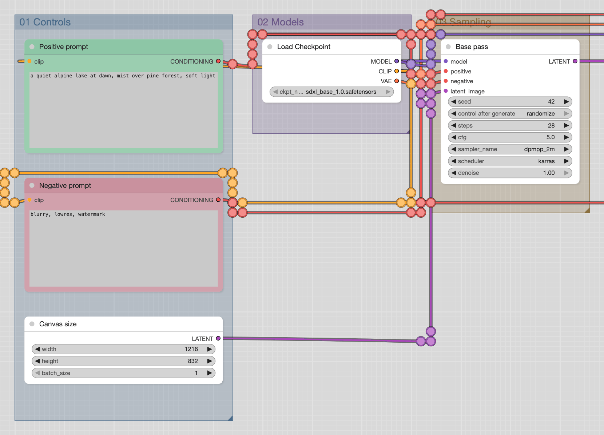
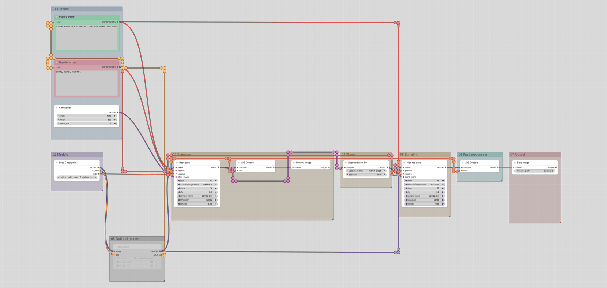
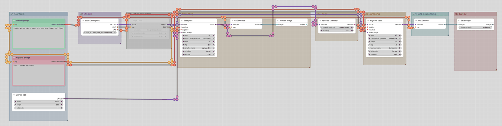
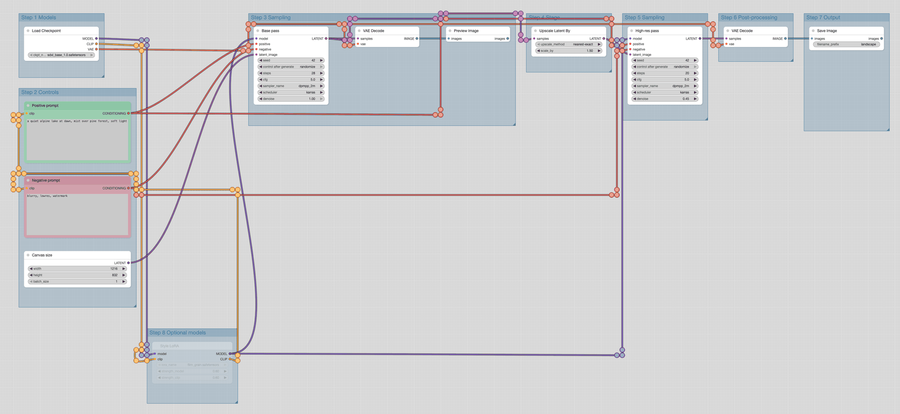

<p align="right"><a href="README.md">English</a> · <a href="showcase/README.zh-CN.md">3 分钟教程与样板间</a></p>

<h1 align="center">comfyui-workflow-compiler (<code>cwc</code>)</h1>

<p align="center">
  把扁平的 ComfyUI API 工作流（AI 编程助手生成的、ComfyUI 导出的、或手写的）一键编译成结构清晰、自动分组、原生拐点（Reroute）走线的 <code>.ui.json</code> 可视化画布，并自动校验导出 Prompt 的 100% 等价性。
</p>

<p align="center">
  <strong>零第三方依赖</strong> · <strong>内置 702 个核心节点定义</strong> · <strong>免安装单文件 <code>cwc.pyz</code></strong> · <strong>7 套专业布局预设</strong> · <strong>画布内嵌使用指南卡</strong>
</p>

<p align="center">
  <picture>
    <source media="(prefers-color-scheme: dark)" srcset="docs/images/hero-dark.png">
    
  </picture>
</p>

上图是 `cwc compile` 将 9 节点高清放大工作流 [`docs/images/src/hires.json`](docs/images/src/hires.json) 编译为 `.ui.json` 后，直接拖入真实 ComfyUI 前端（1.59.1，仅隐藏顶部菜单栏）截取的左半侧画布。完整全画布效果见下方[七套布局预设](#七套布局预设)，开箱即用的示例画布见 [`showcase/`](showcase/README.zh-CN.md)。

---

## 为什么需要 `cwc`？

ComfyUI 存在两套截然不同、默认互不相通的 JSON 格式：
1. **API 格式（`Save (API Format)`）**：由 `{class_type, inputs}` 组成的扁平字典。无论是写 Python 脚本还是让 AI 编程助手（Claude Code、Cursor、Gemini、Codex）生成和审阅都非常轻松，但**拖进 ComfyUI 网页却没有排版布局**。
2. **UI 画布格式（`.ui.json`）**：前端 LiteGraph 的视觉场景图。每个节点都必须写死像素坐标、随渲染器（Classic / Vue）变化的宽高尺寸、包含隐藏伪控件（如 `control_after_generate`）的 `widgets_values` 位置数组、全局 `links` 槽位表以及分组外框坐标。如果让大模型直接手算 UI JSON，经常出现控件错位、节点重叠、连线横穿全屏的“意大利面条图”。

`cwc` 就是这两套格式之间的**工作流编译器**：你（或 AI 助手）只需编写干净的 API JSON（可附带极简的 `_meta` 意图标签），`cwc` 会在毫秒级离线完成节点与类型校验、阶段自动分组、双渲染器防撞排版、原生拐点走线，并严格证明编译出的画布导出的 API Prompt 与输入完全一致。

---

## 快速上手（三种零门槛方式）

需要 **Python 3.10+**；核心编译器**只使用 Python 标准库，零第三方依赖**。

### 方式一：免安装单文件 (`cwc.pyz`) 或 Windows/Mac 拖拽懒人包（推荐普通玩家）
从 Releases 下载 `cwc.pyz`（仅 `~395 KB`）或 `cwc-portable.zip`（也可以在本地用 `python3 tools/build_pyz.py --portable -o dist` 一秒生成）：

- **Windows 鼠标拖拽一键编译**：解压 `cwc-portable.zip`，直接把任意 ComfyUI API `.json` 文件拖到 **`compile-drop-here.bat`** 图标上松手。同目录下会立刻生成 `out/` 文件夹，里面包含可直接拖进 ComfyUI 网页的 `<名称>.ui.json` 和无需开 ComfyUI 就能预览的 `<名称>.svg` 矢量图！
- **单文件命令行（Windows / macOS / Linux 免 `pip install`）**：
  ```bash
  python3 dist/cwc.pyz compile showcase/03-optional-style-lora.json -o out
  python3 dist/cwc.pyz render out/03-optional-style-lora.ui.json -o out/preview.svg
  ```

### 方式二：`uvx` 免克隆一行即跑
```bash
uvx --from git+https://github.com/lepetitprince716-prog/comfyui-workflow-compiler cwc compile graph.json -o out
```

### 方式三：本地克隆安装（适合开发者与 AI Agent）
```bash
git clone https://github.com/lepetitprince716-prog/comfyui-workflow-compiler
cd comfyui-workflow-compiler
python3 -m venv .venv && . .venv/bin/activate
pip install .
cwc compile docs/images/src/hires.json -o out
```

```text
G9 warning: the canvas extent is 2560 x 820, aspect ratio 3.12; it should be 1 to 2.8
cwc compile: ok; preset bento; 7 groups, 0 optional modules, 1 warning; preview: cwc render out/hires.ui.json -o hires.svg
wrote out/hires.ui.json
wrote out/hires.api.json
wrote out/hires.report.json
```

直接把生成的 `out/hires.ui.json` 拖进 ComfyUI 画布即可打开。`hires.api.json` 是该画布导出的等价 API Prompt（可选模块默认旁路），`hires.report.json` 记录了所有几何测量值与检查结论。

> **想看手把手图文教程？** 请打开 **[3 分钟手把手教程与工作流样板间 (`showcase/README.zh-CN.md`)](showcase/README.zh-CN.md)**；如果你平时用 Claude Code / Cursor / Codex / Antigravity 写工作流，直接看下方 **[1 分钟防呆快速配置（Agent 一键上手）](#1-分钟防呆快速配置agent-一键上手)**。

---

## 给 AI 编程助手（Coding Agents）使用

### 1 分钟防呆快速配置（Agent 一键上手）

#### 方式 A：全自动复制粘贴提示词（最省心，零手动配置）
直接把下面这段话原样发给 **Claude Code、Antigravity、Codex、Cursor 或 Gemini CLI**，让 Agent 自己把工具和 Skill 一次配齐：

```text
请帮我配置 comfyui-workflow-compiler (cwc) 并接入你的技能库：
1. 安装 `cwc` 命令：优先运行 `uv tool install git+https://github.com/lepetitprince716-prog/comfyui-workflow-compiler`（没有 uv 可改用 `pip install --user git+https://github.com/lepetitprince716-prog/comfyui-workflow-compiler`，或免安装使用 `uvx --from git+https://github.com/lepetitprince716-prog/comfyui-workflow-compiler cwc`）。
2. 从 https://github.com/lepetitprince716-prog/comfyui-workflow-compiler 把 `skills/comfyui-workflow-compiler/SKILL.md` 安装到你当前生效的 skills / rules 目录。
3. 运行 `cwc presets` 验证环境可用，并读一遍 `cwc guide`。
以后凡是我让你写 ComfyUI 工作流，一律先写声明式 API JSON，再用 `cwc compile --preset square --portable`（需要宽屏多步对比时用 `--preset gallery`）编译并修到 `ok`，最后用 `cwc render ... --values` 输出预览图给我确认。
```

#### 方式 B：一行命令永久安装 CLI + Skill（macOS / Linux）
全局安装一次 `cwc` 命令行，再按你使用的 Agent 把内置 Skill 文件夹复制过去即可：

```bash
# 1. 全局安装 cwc（二选一：推荐 uv tool，或直接用 pip）
uv tool install git+https://github.com/lepetitprince716-prog/comfyui-workflow-compiler
# 若未安装 uv：pip install --user git+https://github.com/lepetitprince716-prog/comfyui-workflow-compiler

# 2. 自检（能打印出全部 7 套布局预设即说明配置成功）
cwc presets

# 3. 拉取仓库中的 Skill 目录并复制到对应 Agent
git clone --depth 1 https://github.com/lepetitprince716-prog/comfyui-workflow-compiler /tmp/cwc-skill
```

| 你使用的 Coding Agent | 复制 Skill 的一条命令 |
|---|---|
| **Claude Code** | `mkdir -p ~/.claude/skills && cp -R /tmp/cwc-skill/skills/comfyui-workflow-compiler ~/.claude/skills/` |
| **Codex CLI** | `mkdir -p ~/.codex/skills && cp -R /tmp/cwc-skill/skills/comfyui-workflow-compiler ~/.codex/skills/` |
| **Antigravity (AGY)** | `mkdir -p ~/.gemini/config/skills && cp -R /tmp/cwc-skill/skills/comfyui-workflow-compiler ~/.gemini/config/skills/` |
| **OpenCode / Pi / 通用 Agent** | `mkdir -p ~/.agents/skills && cp -R /tmp/cwc-skill/skills/comfyui-workflow-compiler ~/.agents/skills/` |
| **Cursor** | 将 `skills/comfyui-workflow-compiler/SKILL.md` 复制到项目的 `.cursor/rules/cwc.mdc`（或对话时直接 `@SKILL.md`） |

> **Windows / 懒得装环境提示**：甚至不需要 `git` 或 `pip`——从 Releases 下载单文件 `cwc.pyz` 放进目录，直接让 Agent 调 `python dist/cwc.pyz guide` 和 `python dist/cwc.pyz compile ...` 即可开箱即用。

#### 方式 C：配好后怎么使唤 Agent（日常开箱模板）
配置完成后，以后做任何 ComfyUI 工作流，直接说人话就行：

```text
帮我做一个 <你的模型/任务> 的两阶段 ComfyUI 工作流，带可选 LoRA 开关、阶段预览和画布内使用指南卡。
用 cwc 编译（`--preset square --portable`），把所有报错和警告修到 `ok`，并用 `--values` 渲染预览图给我看。
（如果用到第三方自定义节点，补一句：节点定义取自 `--nodedefs http://127.0.0.1:8188` 或导出的 `object_info.json`。）
```

### 四步极速离线闭环

本仓库自带即插即用的 Agent 技能包 [`skills/comfyui-workflow-compiler/SKILL.md`](skills/comfyui-workflow-compiler/SKILL.md)。Agent 只需跑通四步极速离线闭环：

1. `cwc guide`：打印单页编写规范（输入格式、所有 `_meta` 与 `_workflow` 键的作用，以及带可选 LoRA 的完整示例）。
2. `cwc node TYPE`：查询任意节点的输入插槽、控件默认值、下拉框枚举值与输出类型；`cwc node --search KW` 支持按关键词搜索全部 702 个内置核心节点。
3. `cwc compile GRAPH.json -o out`：编译并校验。错误和警告在 stderr 输出并附带修复提示（`hint`）；加 `--json` 可输出结构化的 `finding_list` 与计数 `findings`。
4. 根据提示修正直至摘要行显示 `ok`，最后用 `cwc render` 渲染出 `.svg` 矢量图预览画布。

拼写错误会自动给出最接近的候选建议：

```text
E2: node 'sampler': KSampler has no input 'sampler_nme'; did you mean 'sampler_name'?
  hint: valid inputs: model, seed, steps, cfg, sampler_name, scheduler, positive, negative, latent_image, denoise
cwc compile: removed out/steps.ui.json, out/steps.api.json from an earlier run, which this run does not replace
cwc compile: 1 error(s); see out/steps.report.json
wrote out/steps.report.json
```

### 产物契约与退出码

对于名为 `<name>.json` 的输入文件，`cwc compile` 保证：
- 始终写出 `<name>.report.json`；编译成功时一并写出 `<name>.ui.json`、`<name>.api.json`，加 `--all-enabled` 时额外写出所有可选模块开启后的 `<name>.full.api.json`。
- 自动清理上一次运行遗留、而本次未生成的同名旧产物（并在 stderr 明确列出），绝不让编译失败时的旧画布冒充新结果。
- 编译成功时在 stderr 末尾输出一行摘要：选用的预设（`auto` 模式下附带命中规则）、分组数、可选模块数、警告数及 `cwc render` 预览命令。

所有子命令共用同一套退出码：

| 退出码 | 含义 |
|---|---|
| 0 | 成功完成 |
| 1 | 校验未通过（仅写出报告）；或 `cwc node --search` 无匹配结果 |
| 2 | 命令行参数用法错误 |
| 3 | 输入文件不可读、JSON 格式错误或未通过编写检查；或 `cwc node TYPE` 传入了未知节点类型 |
| 4 | 节点定义源不可用、不可读或格式错误 |
| 5 | 输出文件写入失败（已尽力清理当次运行的半成品文件） |
| 70 | `cwc` 内部异常（在 stderr 单行报告） |

---

## 输入格式与 `_meta` 标注

输入就是一张标准的 ComfyUI API 图：每个节点包含 `class_type` 与 `inputs`，连线写为 `[源节点ID, 输出名或索引]`。你可以使用易读的字符串作为节点 ID（例如 `"sampler"`），有默认值的输入可以直接省略。即使不写任何 `_meta` 标注，`cwc` 也会根据数据流拓扑自动推断分组（如 `hires.json`）。

下面是 [`docs/images/src/landscape.json`](docs/images/src/landscape.json) 中的一个可选 LoRA 节点示例：

```json
"lora": {
  "class_type": "LoraLoader",
  "inputs": {
    "model": ["ckpt", "MODEL"], "clip": ["ckpt", "CLIP"],
    "lora_name": "film_grain.safetensors",
    "strength_model": 0.6, "strength_clip": 0.6
  },
  "_meta": {"title": "Style LoRA", "ui_optional": true}
}
```

`"ui_optional": true` 会将该节点归入独立的 **Optional models** 分组，并在生成的画布中默认设为旁路状态（`mode: 4`，即下方预设截图中变暗的 `Style LoRA` 节点）。完整键表可随时运行 `cwc guide` 查看。

---

## `Controls` 驾驶舱分组

位于画布最左侧的 **Controls** 分组专门收纳用户每次跑图都要调整的核心参数。正负提示词和 `EmptyLatentImage`（图像尺寸）会自动归入 `Controls`。

你可以给任何其他节点加上 `"ui_role": "cockpit"` 将它提进左侧驾驶舱，或用 `"ui_role": "pipeline"` 将某个提示词留在流水线内部。例如，把采样步数抽成一个独立的驾驶舱旋钮：

```json
"steps": {"class_type": "PrimitiveInt", "inputs": {"value": 28},
          "_meta": {"title": "Steps", "ui_role": "cockpit"}},
"sampler": {"class_type": "KSampler", "inputs": {"steps": ["steps", 0], ...}}
```

编译成功后，`report.json` 的 `metrics.authoring_keys` 会明确记录哪些 `_meta` 标注已在画布上生效（`nodes` 列出已体现的节点，`no_effect_on` 列出被覆盖或未生效的节点）：

```json
"authoring_keys": [
 {"key": "_meta.title", "nodes": ["steps"]},
 {"key": "_meta.ui_role", "nodes": ["steps"]}
]
```

已接受但当前版本暂不改变画布外观的预留键，会在每次编译的 `E8` info 结论中统一列出。

---

## 七套布局预设

通过 `--preset <名称>`（或 JSON 顶层的 `_workflow.layout.preset`）即可切换排版架构；运行 `cwc presets` 可查看每种预设的适用场景。下面是同一个 12 节点工作流 `landscape.json` 在五套经典预设下的实机编译效果，以及新增的 **`gallery`**（宽屏多步预览画廊）与 **`square`**（四方形 / 4:3 紧凑仪表盘）两套预设：

### `bento`（默认便当盒网格）

<picture>
  <source media="(prefers-color-scheme: dark)" srcset="docs/images/bento-dark.png">
  
</picture>

**默认预设。** 左侧放 `Controls` 驾驶舱，随后模型与提示词并排，接着采样、后处理与输出沿主干行依次展开；ControlNet 控制分支与可选模块整齐排列在下方的第二行。当主干行宽度超过自身高度的 2.4 倍时自动优雅折行。

### `swimlanes`（分阶段泳道列）

<picture>
  <source media="(prefers-color-scheme: dark)" srcset="docs/images/swimlanes-dark.png">
  
</picture>

左侧放 `Controls`，其余各个处理阶段按数据流顺序严格一阶段一列；每条控制或遮罩分支直接停靠在它所控制的采样阶段正下方。

### `cockpit-split`（双层分舱驾驶舱）

<picture>
  <source media="(prefers-color-scheme: dark)" srcset="docs/images/cockpit-split-dark.png">
  
</picture>

主干列与 `swimlanes` 一致，但当 `Controls` 中既包含核心输入（正负提示词、参考图、尺寸、随机种子）又包含次要调参旋钮时，会自动上下拆分为「主控框」与「次级调参框」，最适合 60+ 节点的大型工作流。

### `tower-preview`（右侧巨幅预览塔）

<picture>
  <source media="(prefers-color-scheme: dark)" srcset="docs/images/tower-preview-dark.png">
  
</picture>

在 `bento` 布局基础上把最右侧的输出组扩展到至少 `880 × 680` 像素，让预览/保存节点撑满右侧画廊区，非常适合边改提示词边看大图的小型工作流。

### `stepped`（分步教学流水线）

<picture>
  <source media="(prefers-color-scheme: dark)" srcset="docs/images/stepped-dark.png">
  
</picture>

将第一列固定为上下堆叠的 `Models` 与 `Controls`，后续处理阶段依次命名为 `Step 1`、`Step 2`、`Step 3`，专为教学文章与分步演示工作流打造。

### `gallery`（多步预览与对照画廊）

专为**带中间步骤预览或可选 A/B 对比分支的多阶段工作流**打造：
- 左侧固定 `Controls` 驾驶舱（超过 5 个控件时自动拆为紧凑的左右双列，不再把整张画布拉出纵向大空洞），经 80 px 竖向中轴通道与右侧主干流水线齐平展开，最终成品预览紧贴右上角。
- 自动识别并把中间阶段的预览组（如一阶段构图预览、ROI 裁剪框预览）及可选对照模块紧贴停靠在对应主干步骤正下方（`dock_steps` + 中轴右侧紧凑吸顶），彻底消除传统排版中主干下方的大片死空间。
- 统一放大输出、中间预览与可选对照区的预览窗口（至少 `560 × 540` 像素）；配合节点级 `_meta.ui_collapsed: true`，可在保留阶段分组的前提下折叠纯连线节点（如 `VAEDecode`、`BasicGuider`、`DisableNoise`），让整张画布紧凑且条理清晰。

### `square`（四方形 / 4:3 紧凑仪表盘）

专为**不想左右长距离拖动、偏爱接近正方形（`1.0–1.7:1`）一屏全览**的多阶段工作流与截图展示打造：
- 当整张画布长宽比超过 `1.85:1` 时，自动按行宽均衡原则将多阶段流水线折叠为上下多层，跨行连线通过中间 80 px 水平总线走廊干净走线（`wrap_rows: true`），同时保持每一行内部严格从左到右、零连线穿模（`G2 = 0`、`C3 = 0`、`G9` 全绿）。
- 中间步骤预览与可选对照模块直接收纳在各行内部宽度内（不往右侧凸出），折行后的下层直接利用左上角指南卡下方的完整宽度，适合笔记本屏幕、4:3 教程配图及多步复杂工作流。

### `auto`（根据图规模自动选型）

传入 `--preset auto` 时，`cwc` 按顺序匹配第一条成立的规则（并在摘要行和报告中写明命中原因）：

| 工作流拓扑特征 | 自动选用的预设 |
|---|---|
| 节点数 `<= 16` 且不含可选模块 | `tower-preview` |
| 含 `3` 条及以上控制或遮罩分支 | `swimlanes` |
| 节点数 `>= 60` | `cockpit-split` |
| 其余所有情况 | `bento` |

---

## 命令行一览

```text
cwc node     [TYPE | --search KW] [--nodedefs FILE|URL] [--json]
cwc compile  GRAPH.json -o DIR [--nodedefs FILE|URL] [--preset NAME]
             [--all-enabled] [--portable] [--allow-unknown] [--json]
cwc presets  [--json]
cwc guide
cwc learn    FILE [FILE ...] -o FILE [--nodedefs FILE|URL] [--json]
cwc render   GRAPH.ui.json -o OUT.svg [--nodedefs FILE|URL] [--values] [--json]
```

| 命令 | 功能说明 |
|---|---|
| `node` | 查看单个节点定义（输入、控件与默认值、下拉框可选枚举、输出），或按类名/显示名/分类搜索。未知 `TYPE` 退出码为 `3` 并在 stderr 提示最接近的类型；搜索无结果退出码为 `1`（`--json` 下输出 `[]`）。 |
| `compile` | 将 API 图编译为 `<name>.ui.json` 画布与 `<name>.api.json`。加 `--all-enabled` 会额外写出所有可选模块开启时的 `<name>.full.api.json`；加 `--portable` 可在编译公开/可移植工作流时跳过本机模型文件名下拉框的缺失警告，同时保留枚举值与数值范围的严格校验。 |
| `presets` | 列出七套预设的结构特点、适用场景以及 `auto` 的选型规则。 |
| `guide` | 打印单页编写指南。 |
| `learn` | 从成对的 `.ui.json` 画布与 API prompt 中自动学习自定义节点的控件排列模板。 |
| `render` | 无需启动浏览器或 ComfyUI，直接把 `.ui.json` 画布渲染成 `.svg` 矢量图；加 `--values` 可在节点内直出关键参数值、导览说明卡排版与 `IMAGE PREVIEW` / `INPUT IMAGE` 预览框占位。 |

ComfyUI 的 **702 个核心节点定义**已直接打包在 `cwc` 内部。若工作流包含第三方自定义节点（Custom Nodes），只需用 `--nodedefs` 传入导出的 `/object_info` JSON 文件，或正在运行的 ComfyUI 服务器地址（自动读取 `<URL>/api/object_info`，最多跟随 3 次 `http`/`https` 重定向且绝不从 `https` 降级到 `http`；请仅填入你信任的服务器地址）。

<details>
<summary>编写检查的结论代码 (E1–E8)</summary>

报告里的 `title` 字段是同样的英文标识；其他代码族检查的是画布几何与路由。

| 代码 | 含义 |
|---|---|
| E1 | 未知的节点类型 |
| E2 | 这个节点类型没有这个输入名 |
| E3 | 缺了没有声明默认值的必填输入 |
| E4 | 连线两端类型不兼容 |
| E5 | 字面值类型不对、超出范围，或不是已知的选项 |
| E6 | 连线指向不存在的节点或输出，或者输出名有歧义 |
| E7 | 图的结构无效（有环、id 不对、`_workflow` 不对、可选组混搭） |
| E8 | 编写键被接受，但暂时没有效果 |

E7 也涵盖 `cwc` 不认识的 `_meta` 键：以 `ui_` 开头的是错误并提示最接近的键；其他的是警告。同一个节点上一个 `_meta` 键被另一个键覆盖时，会给出一条 E7 警告，点出两个键并提示该删哪个（退出码和 `ok` 不变）。优先级顺序：`ui_role: cockpit` 高于 `ui_group`，`ui_group` 高于 `ui_role: plumbing`，`ui_optional` 高于 `ui_role` 的 `cockpit` 和 `plumbing`。

`cwc` 已接受但当前暂不渲染的预留键（`ui_locked`、`ui_expose`、`_workflow.locale`）每次编译汇总为一条 `E8` info 结论（退出码和 `ok` 不变）。（`_workflow.title`、`_workflow.groups.<id>.note` 与 `_meta.ui_note` 现已直接渲染为画布左上角首屏的 `MarkdownNote` 快速使用指南卡。）

</details>

<details>
<summary>相对本仓库初版变更的行为</summary>

- `cwc node TYPE` 传入未知类型时退出码为 3（初版为 4）；搜索无匹配时退出码为 1（初版为 0）。
- 以 `ui_` 开头但非 `cwc` 支持的 `_meta` 键现为错误（E7，退出码 3），防止拼写错误静默失效。
- 暂未渲染的预留键会在 E8 info 结论中明确点名。
- 同节点上被高优先级键覆盖的 `_meta` 键会触发 E7 警告。

</details>

<details>
<summary>安全输入上限</summary>

所有外部输入在入口处做一次边界检查，超出以下上限即拒绝并指明命中的上限（日常大型工作流通常仅几百个节点、几 MB）：

| 输入项 | 上限 | 超出时的响应 |
|---|---|---|
| 单个输入文件（画布、编写文件、PNG）读取量 | 256 MiB（含管道或增长中的文件） | I3，退出码 3 |
| 单个 JSON 文档或单个 PNG 文本块 | 64 MiB | I3，退出码 3 |
| 单个 PNG 的所有压缩文本块解压后总和 | 64 MiB | I3，退出码 3 |
| JSON 数组与对象嵌套深度 | 64 层 | I3，退出码 3 |
| 画布节点数或编写条目数 | 5000 | I3，退出码 3 |
| 画布连线数 | 20000 | I3，退出码 3 |
| 节点、连线、插槽或 reroute 的整数/数字串 ID | 32 位数字 | I1，退出码 3 |
| 纯数字组成的编写键 | 32 位数字 | E7，退出码 3 |
| 画布坐标或尺寸（节点、组、reroute）绝对值 | `1e9` | I1，退出码 3 |
| 节点定义源（文件、URL 响应或 gzip 解压后） | 64 MiB，嵌套 64 层 | D1，退出码 4 |
| URL 节点定义源跟随重定向次数 | 3 次（仅限 http/https，禁 https 降级） | D1，退出码 4 |
| 节点定义中 Autogrow 的 `min` 或 `max` | 1000 | D1，退出码 4 |
| 单个 Autogrow 组的总槽位数（模板输入数 × `max`） | 10000 | D1，退出码 4 |
| `learn` 单节点控件值数 × 候选名数对齐矩阵 | 250000 格 | 仅按长度投票（`too_large`），不报错 |

</details>

---

## 架构文档与项目状态

- **当前已就绪**：完整编译管线（`normalize` → `instantiate` → `annotate` → `layout` → `route` → `notes` → `verify`）、七套布局预设（含宽屏多步预览专用 `gallery` 与四方形/4:3 紧凑仪表盘专用 `square`）、画布内嵌 `MarkdownNote` 使用指南卡（通过 `C5`/`G8` 校验）、`--portable` 可移植编译、`_meta.ui_collapsed` 组内管道节点折叠、`render --values` 参数与预览框可视化、六个核心命令、单文件免安装包构建器（`tools/build_pyz.py`）、Agent 技能包（[`skills/`](skills/comfyui-workflow-compiler/SKILL.md)）以及 [`showcase/`](showcase/README.zh-CN.md) 教程样板间。
- **下一阶段计划（M3）**：保持拓扑不变的无损画布整理（`cwc beautify`）、二阶段通道加宽路由、以及 PNG 工作流元数据嵌入与提取（`cwc embed` / `cwc extract`）。

深度工程与前端实测文档（英文）：
- [`docs/ARCHITECTURE.md`](docs/ARCHITECTURE.md) — 模块边界、排版算法与校验规则。
- [`docs/m0-findings.md`](docs/m0-findings.md) — 基于真实 ComfyUI 0.45.0 / frontend 1.59.1 的浏览器自动化实测结论。
- [`docs/m1-templates.md`](docs/m1-templates.md) — 控件位置模板与隐藏伪控件（`control_after_generate` 等）推导。
- [`docs/m2-frontend-facts.md`](docs/m2-frontend-facts.md) — 前端分组归属、Classic/Vue 节点包围盒与拐点走线几何事实。

运行单元测试：`python3 -m unittest discover -s tests`（仅在运行 `tools/oracle/` 真实浏览器校验台或用 [`tools/make_readme_images.py`](tools/make_readme_images.py) 重新截取 README 画布图时才需要 Playwright）。

<details>
<summary>里程碑 (Milestones)</summary>

| 里程碑 | 核心内容 | 状态 |
|---|---|---|
| M0 | 真实前端浏览器校验台；测量布局算法依赖的底层常数（`tools/oracle/`、`docs/m0-findings.md`） | 已完成 |
| M1 | 节点实例化与等价性证明；将 API 图编译为导出相同 Prompt 的画布（`docs/m1-templates.md`） | 已完成 |
| M2 | 七套布局预设（含 `gallery` 与 `square`）、双渲染器排版与原生连线路由检查（`docs/ARCHITECTURE.md`、`docs/m2-frontend-facts.md`） | 已完成 |
| M3 | 画布内嵌 `MarkdownNote` 导览指南卡（已完成）；二阶段拐点走线优化、已有画布无损整理（`beautify`）、PNG 嵌入与提取 | 进行中 |
| M4 | 编程 Agent 技能包（[`skills/`](skills/comfyui-workflow-compiler/SKILL.md)）、`cwc.pyz` 免安装懒人打包（`tools/build_pyz.py`）与 [`showcase/`](showcase/README.zh-CN.md) 样板间 | 已完成 |
| M5 | 首个正式版之后的可选扩展 | 计划中 |

</details>

## 开源许可 (Licence)

代码采用 Apache License 2.0（[`LICENSE`](LICENSE)）。`cwc` 为你编译生成的产物文件（`.ui.json`、`.api.json`、`.svg` 及检查报告）著作权完全归工作流作者本人所有，不受本仓库许可证约束，详见 [`LICENSE-OUTPUTS.md`](LICENSE-OUTPUTS.md)。

本仓库未复制任何 GPL 或 AGPL 项目的代码或受版权保护的数据；内置的核心节点快照仅保留互操作所需的接口事实（名称、类型、顺序）。
