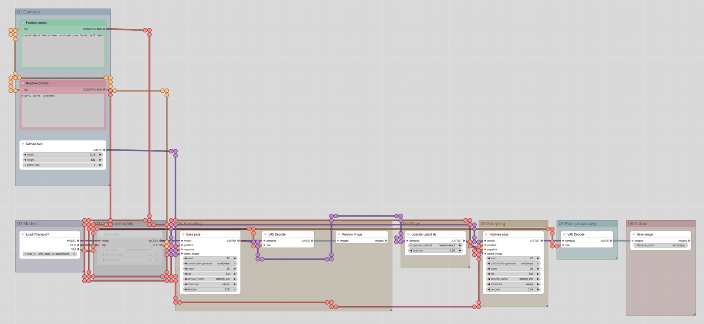
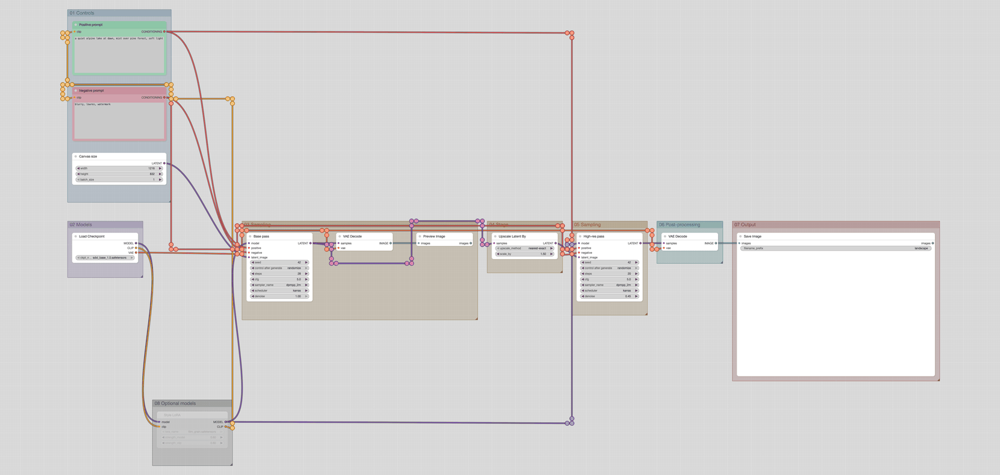

<p align="right"><a href="README.md">English</a></p>

<h1 align="center">comfyui-workflow-compiler</h1>

<p align="center">
  <code>cwc</code> 把一张 ComfyUI API 图（编程 agent 写的或手写的）编译成人看得懂的画布：分好组、排好版、用原生 reroute 连线，并且检查过它导出的 prompt 和编译前的一致。
</p>

<p align="center"><code>pip install .</code> 之后 <code>cwc compile graph.json -o out</code></p>

<p align="center">
  <picture>
    <source media="(prefers-color-scheme: dark)" srcset="docs/images/hero-dark.png">
    
  </picture>
</p>

上图是 `cwc compile` 为 [`docs/images/src/hires.json`](docs/images/src/hires.json) 写出的画布的左边部分。这张图有九个节点，做文生图再加一遍高清放大。图是 ComfyUI 前端的截图，只隐藏了前端自己的菜单。完整的画布见[五种预设](#五种预设)。

## 试一下

需要 Python 3.10 或更新版本；核心只用标准库。

```bash
git clone https://github.com/lepetitprince716-prog/comfyui-workflow-compiler
cd comfyui-workflow-compiler
python3 -m venv .venv && . .venv/bin/activate
pip install .
cwc compile docs/images/src/hires.json -o out
```

```text
wrote out/hires.ui.json
wrote out/hires.api.json
wrote out/hires.report.json
```

把 `out/hires.ui.json` 拖到 ComfyUI 画布上就能打开。`hires.api.json` 是这张画布导出的 prompt，可选模块处于旁路状态；`hires.report.json` 是各项检查的结论和测量值。

## 输入是什么

一张 API 图：每个节点是一个 `class_type` 加它的 `inputs`，连线写成 `[节点, 输出]`。节点 id 可以用名字。`_meta` 里的提示可写可不写；不写时 `cwc` 从图的结构推断分组，`hires.json` 就是这样。下面是 [`docs/images/src/landscape.json`](docs/images/src/landscape.json) 里的两个节点：

```json
"lora": {
  "class_type": "LoraLoader",
  "inputs": {
    "model": ["ckpt", "MODEL"], "clip": ["ckpt", "CLIP"],
    "lora_name": "film_grain.safetensors",
    "strength_model": 0.6, "strength_clip": 0.6
  },
  "_meta": {"title": "Style LoRA", "ui_optional": true}
},
"pos": {
  "class_type": "CLIPTextEncode",
  "inputs": {
    "clip": ["lora", "CLIP"],
    "text": "a quiet alpine lake at dawn, mist over pine forest, soft light"
  },
  "_meta": {
    "title": "Positive prompt", "ui_role": "cockpit"
  }
}
```

`ui_optional` 把节点放进一个可选模块，画布交出去时这个模块是旁路的（下面各图里 Optional models 组中变暗的 Style LoRA）。`ui_role: "cockpit"` 把节点提到 Controls 组，那是每次运行都要改的地方。

## 五种预设

`--preset` 决定怎么排。下面是同一张十二个节点的图 `landscape.json` 在各个预设下的样子：

### bento

<picture>
  <source media="(prefers-color-scheme: dark)" srcset="docs/images/bento-dark.png">
  
</picture>

默认预设。左边是 Controls，往右依次是模型、按列排开的各个采样阶段、后处理和输出；可选模块和控制分支放在下面一排。

### swimlanes

<picture>
  <source media="(prefers-color-scheme: dark)" srcset="docs/images/swimlanes-dark.png">
  
</picture>

先是 Controls 组，其余各组排成一行。控制分支站在它所控制的那个阶段的那一列里。

### cockpit-split

<picture>
  <source media="(prefers-color-scheme: dark)" srcset="docs/images/cockpit-split-dark.png">
  
</picture>

排成一行，每个阶段的组在同一列里上下叠放。Controls 组里除了核心控件（提示词、参考图、尺寸、种子）还有别的控件时，其余的放进紧挨在下面的第二个框。

### tower-preview

<picture>
  <source media="(prefers-color-scheme: dark)" srcset="docs/images/tower-preview-dark.png">
  
</picture>

和 bento 一样，另外在输出处留出放大预览图的位置。

### stepped

<picture>
  <source media="(prefers-color-scheme: dark)" srcset="docs/images/stepped-dark.png">
  
</picture>

组名按步骤编号，全部用前端默认的组颜色，模型和控件放在第一列。

### auto

`--preset auto` 按顺序取第一条成立的规则：

| 图 | 预设 |
|---|---|
| 不超过 16 个节点，且没有可选模块 | `tower-preview` |
| 三条及以上控制或蒙版分支 | `swimlanes` |
| 60 个节点及以上 | `cockpit-split` |
| 其余 | `bento` |

不给 `--preset` 时，`cwc` 用图里的 `_workflow.layout.preset`，没有就用 `bento`。

## 命令

```text
cwc node     [TYPE | --search KW] [--nodedefs FILE|URL] [--json]
cwc compile  GRAPH.json -o DIR [--nodedefs FILE|URL] [--preset NAME]
             [--all-enabled] [--allow-unknown] [--json]
cwc learn    FILE [FILE ...] -o FILE [--nodedefs FILE|URL] [--json]
cwc render   GRAPH.ui.json -o OUT.svg [--nodedefs FILE|URL] [--json]
```

| 命令 | 作用 |
|---|---|
| `node` | 显示一个节点定义，或按名字、显示名、分类搜索。 |
| `compile` | 把 API 图编译成画布和它的 API prompt。加 `--all-enabled` 还会写出 `<name>.full.api.json`，即所有可选模块都打开时的 prompt。 |
| `learn` | 从成对的画布和 API prompt 里学习控件模板。 |
| `render` | 不用浏览器，把画布画成 SVG。 |

核心节点的定义已经打包在内。用到自定义节点时，用 `--nodedefs` 传入 `/object_info` 导出的文件，或者一个正在运行的 ComfyUI 服务器的地址。

## 现状

预览阶段（pre-alpha）。已经能用的：完整的编译流程（normalize、instantiate、annotate、layout、route、verify），五种预设，以及上面四个命令。

计划中，`cwc --help` 里还没有：

```text
cwc beautify messy.ui.json [--preset ...] [--regroup] -o out/
cwc check    x.ui.json [--api x.api.json] [--live URL] [--publish]
cwc embed    x.ui.json --image cover.png -o x.workflow.png
cwc extract  image.png -o out/
cwc snapshot --from URL [--via-frontend] -o nodedefs.json
```

同样在计划中的：只改几何、不动其他内容地整理已有画布，画布内的导览和注释，给编程 agent 用的技能包，以及一组示例工作流。

原理见 [`docs/ARCHITECTURE.md`](docs/ARCHITECTURE.md)（模块和布局规则）、[`docs/m0-findings.md`](docs/m0-findings.md)（真实前端的行为）、[`docs/m1-templates.md`](docs/m1-templates.md)（控件模板）和 [`docs/m2-frontend-facts.md`](docs/m2-frontend-facts.md)（前端怎么存组、节点框和连线），这些文档是英文的。本页的图由 [`tools/make_readme_images.py`](tools/make_readme_images.py) 生成。

## 许可

Apache License 2.0（[`LICENSE`](LICENSE)）。`cwc` 为你写出的文件（`.ui.json`、`.api.json`、`.svg`、报告）归工作流的作者所有，不受这份许可约束，见 [`LICENSE-OUTPUTS.md`](LICENSE-OUTPUTS.md)。

本仓库没有复制任何 GPL 或 AGPL 项目的代码或受版权保护的数据。打包的核心节点快照只保留互操作所需的事实（名称、类型、顺序）。
